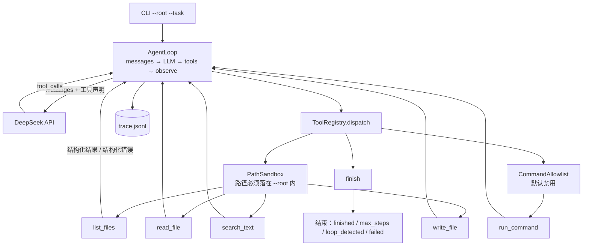

# agent-demo

一个**手写的工具调用型 CLI Agent**。给它一个工作目录和一句自然语言任务，它自己探查目录、定位资料、写出带出处的报告。

不依赖 LangChain / LlamaIndex 等任何 agent 框架——agent 循环、工具协议、终止条件全部自己实现，代码总量不大，可以逐行讲清楚。

```bash
uv run agent-demo --root ./examples \
  --task "把 notes 目录里的资料整理成一份项目进展报告，标注出处"
```

---

## 它长什么样

一次运行会打印完整的「想一步、做一步」链路：

```
root      : /path/to/agent-demo/examples
out-dir   : agent_out/
model     : deepseek-chat
tools     : finish, list_files, read_file, run_command, search_text, write_file
commands  : (禁用)
max-steps : 12
task      : 把 notes 目录里的资料整理成一份项目进展报告，标注出处
----------------------------------------------------------------
[step  1] llm_request  messages=2 条
[step  1] llm_response tool_calls=list_files
[step  1] tool_call    list_files({"path": "notes"})
[step  1] tool_result  list_files -> ok: {"ok": true, "result": "notes/ 共 3 项\ndir   notes/会议纪要/\nfile  notes/…"}
[step  2] llm_request  messages=4 条
[step  2] llm_response tool_calls=read_file
[step  2] tool_call    read_file({"path": "notes/2024-里程碑.md"})
[step  2] tool_result  read_file -> ok: {"ok": true, "result": "# notes/2024-里程碑.md  第 1-20 行 / 共 20 行\n    1| # 星轨项目…"}
...
[step  7] tool_call    finish({"summary": "已生成 agent_out/report.md，含 3 条里程碑与 2 项风险，均标注出处。"})
----------------------------------------------------------------
状态      : finished
轮次      : 7
token     : prompt=… completion=… 合计=…
trace     : agent_out/trace.jsonl
```

> 上面这段是**用回放模型**跑出来的（见「离线回放测试」一节），所以 token 数省略了。
> 换成真实模型时输出结构完全一致。

同样的每一步都会落进 `agent_out/trace.jsonl`，一行一个 JSON，方便事后复盘或做评测集。

---

## 架构



数据流很短：**组装 messages → 问模型 → 执行工具 → 结果回灌 → 再问**，直到出现四种出口之一。

## 四种出口

agent 最容易含糊的地方是「它到底做完了没有」。这里把出口显式化，各有各的状态码：

| status | 含义 | 是否算成功 |
|---|---|---|
| `finished` | 模型主动调用 `finish` | 是 |
| `no_tool_calls` | 模型不再用工具，直接给文本作答 | 是 |
| `max_steps` | 步数耗尽仍未结束，**任务未确认完成** | 否 |
| `loop_detected` | 同一工具 + 完全相同的参数连续重复，主动掐断 | 否 |
| `failed` | 模型调用失败或响应异常 | 否 |

退出码：成功 `0`，其余 `1`，配置错误 `2`。

---

## 快速开始

需要 Python 3.12+ 和 [uv](https://docs.astral.sh/uv/)。

```bash
uv sync

# 配置密钥（二选一）
export DEEPSEEK_API_KEY=sk-...
cp .env.example .env   # 然后把 key 填进去；.env 已在 .gitignore

# 跑起来
uv run agent-demo --root ./examples \
  --task "把 notes 目录里的资料整理成一份项目进展报告，标注出处"
```

产出：

- `examples/agent_out/report.md` —— agent 写的报告
- `examples/agent_out/trace.jsonl` —— 每一步的结构化记录

`examples/` 里是**为此演示虚构的**零散笔记（里程碑、会议纪要、决策记录分散在不同文件与子目录），
足以体现「先探查、再定位、最后综合」的过程。换成你自己的资料，直接改 `--root` 即可。

### 常用参数

```bash
--out-dir agent_out      # 产出目录，必须位于 --root 内
--max-steps 12           # 最多几轮 LLM 交互，硬上限
--model deepseek-chat    # 也支持 deepseek-reasoner
--allow-cmd wc,head      # 放行命令（默认空 = 完全禁用）
--dry-run                # 只演练：不写文件、不执行命令
--quiet                  # 只打印结论
```

---

## 工具集

六个工具，全部用 JSON Schema 声明，模型看到的就是这张表：

| 工具 | 边界 |
|---|---|
| `list_files` | 只能列 `--root` 内的目录 |
| `read_file` | 带行号返回，超长自动截断并明确告知；单文件上限 1 MB |
| `search_text` | 纯 Python 正则，不依赖 ripgrep；自动跳过 `.git`、`node_modules` 与 `--out-dir` |
| `write_file` | **路径以 `--out-dir` 为基准**，因此不可能覆盖到原始资料 |
| `run_command` | 默认禁用；白名单 + `shell=False` + 固定 `cwd` + 30 秒超时 |
| `finish` | 显式宣告完成 |

新增一个工具只需要三步：写一个 `handler(ctx, **args) -> str`、写它的 JSON Schema、挂进 `build_registry`。循环层不用改。

---

## 四个关键设计

### 1. 工具报错不中断循环

工具失败会被包成结构化错误回灌给模型，让它自己换条路走：

```json
{"ok": false, "error": "FileNotFoundError: notes/缺失.md 不是可读文件",
 "hint": "路径可能拼错了，先用 list_files 确认目录内容。"}
```

`hint` 是按异常类型给的、可执行的下一步建议。这是 agent 相对固定 pipeline 的核心价值，
也是 `test_tool_error_is_recovered_by_model` 在守的行为。

### 2. 路径沙箱

凭什么让一个 LLM 去动文件系统？两条边界：

- **读**：`resolve()` 展开符号链接后再校验是否位于 `--root` 之内，同时挡住 `../` 逃逸和软链接逃逸
- **写**：路径以 `--out-dir` 为基准解析，因此写 `notes/alpha.md` 落到的是 `agent_out/notes/alpha.md`，**不可能覆盖输入资料**
- **命令**：白名单 + 裸命令名 + `shell=False`，管道、重定向、`&&` 都不会被解释

`tests/test_safety.py` 里每种逃逸手法都有一条对应的测试。

### 3. 结构化 trace

`trace.jsonl` 每条记录带 `ts / step / event / payload`，`event` 取值有
`llm_request`、`llm_response`、`tool_call`、`tool_result`、`finish`、`error`。
它同时是演示素材、排障依据和成本台账（累计 token 在结束时打印）。

### 4. 离线回放测试

`tests/conftest.py` 里的 `FakeLLM` 实现同一个协议，按预置「剧本」逐轮返回响应。
于是整个循环可以在**不联网、不花一分钱 token** 的前提下被完整测试。

这是这个项目相对多数 agent demo 最实在的差别：别人的 agent 只能「跑一次看看」，
这里的循环有确定性回归测试——改提示词、换模型、动工具协议，跑一遍就知道有没有退化。

```bash
uv run pytest
# 70 passed
```

覆盖：四种出口各一条、错误恢复、越界拒绝、死循环误判与命中、trace 事件序列、
token 累计、响应归一化的各种畸形输入、`.env` 优先级。

---

## 项目结构

```
src/agent_demo/
├── __main__.py     CLI 入口：参数解析、装配、打印结论
├── config.py       配置优先级：命令行 > 环境变量 > 默认值；自带极简 .env 读取
├── llm.py          DeepSeek 客户端，把响应归一化成内部结构；重试与超时
├── loop.py         agent 主循环（核心，约 210 行）
├── safety.py       路径沙箱与命令白名单
├── trace.py        JSONL trace
└── tools/
    ├── registry.py 工具声明、参数校验、统一 dispatch 与错误包装
    ├── files.py    list_files / read_file / write_file
    ├── search.py   search_text
    ├── shell.py    run_command
    └── finish.py   finish
tests/              70 个离线测试
examples/           虚构的演示资料
```

---

## 为什么不用 LangChain

不是因为它不好，而是这个规模的项目里，框架会把我最想讲清楚的部分（循环、终止条件、错误恢复、工具协议）藏起来。

代价我也认：没有现成的多模型适配、没有 callback 生态、没有现成的记忆/检索组件。
作为一个演示 agent 骨架的项目，这个交换是划算的；要接十种模型或做复杂 RAG，就该上框架了。

---

## 已知局限

- 只支持 OpenAI 兼容协议的接口，没有做多供应商适配
- 没有向量检索：长文档只能靠 `search_text` 定位，上下文靠截断控制
- 单进程串行执行工具，没有并行工具调用
- 命令白名单是**运维层面的粗糙防线，不是安全沙箱**——真要跑不可信命令，得上容器隔离
- 没有做上下文压缩，很长的任务会在 `max_steps` 处停下

## 环境注意事项

`httpx` 0.28 在**构造 Client 时**会解析 `no_proxy`，遇到 `[::1]` 这类带方括号的 IPv6 字面量
会直接抛 `InvalidURL: Invalid port: ':1]'`——和请求无关，构造阶段就炸。

`llm.py` 里的 `sanitize_no_proxy()` 会在建客户端之前剔除这类条目（它们只影响"哪些地址不走代理"，剔除无实际影响，有对应测试）。
